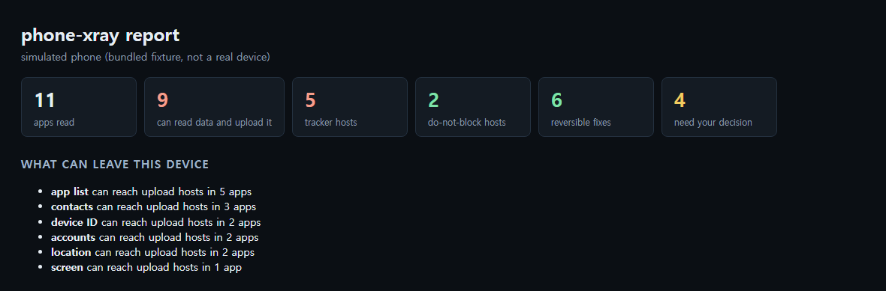
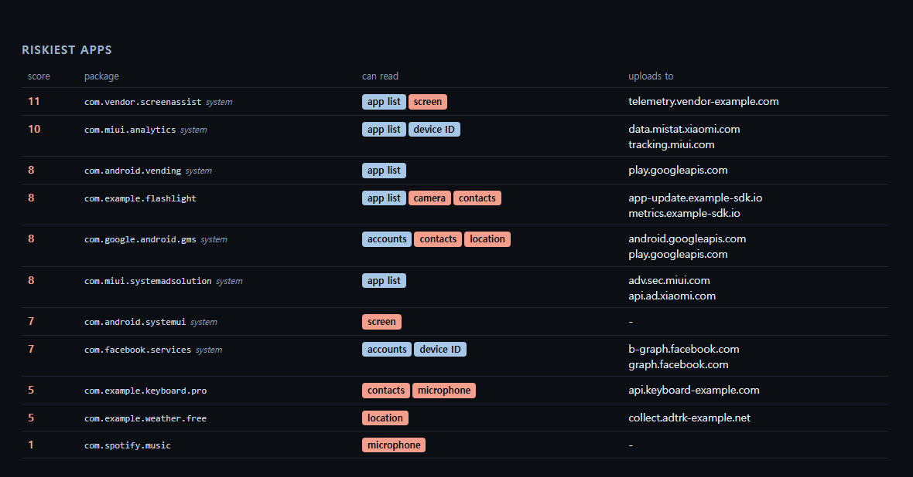
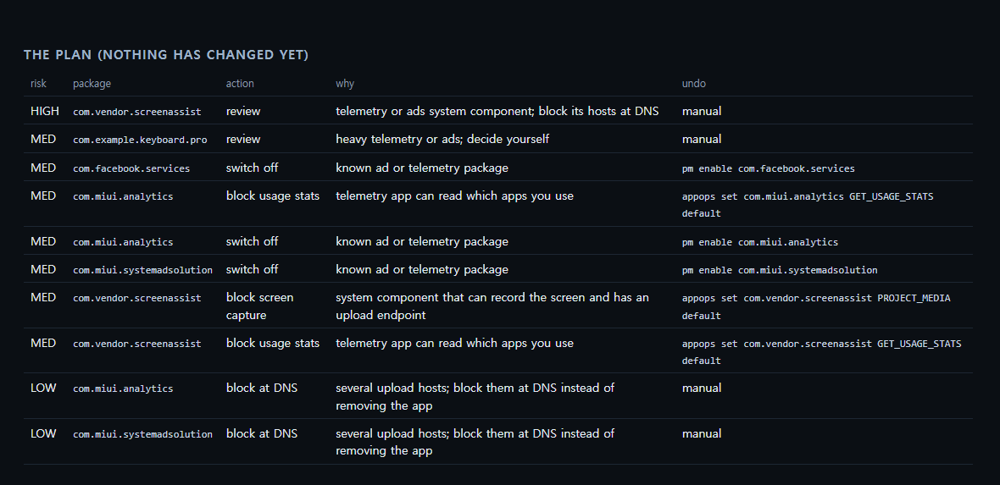
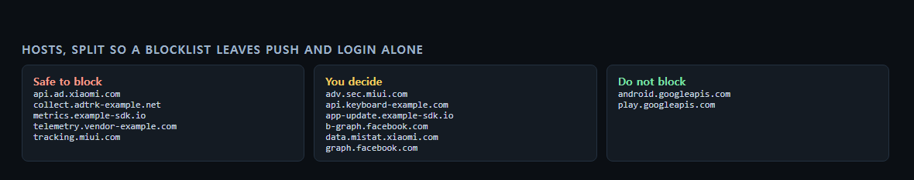

<div align="center">

# phone-xray

**See what any Android phone or TV can leak, then switch it off with one-step undo.**

One Python file, no root and no JDK. It takes the audit idea from [NOIR](https://github.com/Verlintas/NOIR) and the plan-first, undo-everything flow from [Clean Your TV app](https://github.com/udhaykumarbala/cleanyourtv-app).

Works with **Claude Code** and **Codex**.

 



<sub>Real output from `--demo`, which reads a bundled simulated phone. Packages named `com.example.*` are made up.</sub>

</div>

## Install in Claude Code or Codex

```bash
/plugin marketplace add Dodai0419/phone-xray
/plugin install phone-xray@phone-xray
```

```bash
git clone https://github.com/Dodai0419/phone-xray && cp -r phone-xray/skills/* ~/.codex/skills/
```

Then ask: "Audit my phone and show me what it can leak."

## Quick start

No device needed for the first run:

```bash
git clone https://github.com/Dodai0419/phone-xray && cd phone-xray
python phone_xray.py --demo
```

```text
11 apps read, 9 can read personal data and upload it
5 tracker hosts safe to block, 2 hosts left alone
   11  com.vendor.screenassist  app list, screen
   10  com.miui.analytics  app list, device ID
    8  com.android.vending  app list
    8  com.example.flashlight  app list, camera, contacts
    8  com.google.android.gms  accounts, contacts, location
plan: 6 reversible fixes, 4 for you to decide. Nothing changed yet.
report: xray-report/report.html
```

On your own device, with USB debugging on:

```bash
python phone_xray.py
```

On an Android TV or Google TV on your Wi-Fi, with network debugging on:

```bash
python phone_xray.py --connect 192.168.1.50:5555
```

## What you get

Open `xray-report/report.html`. Everything below is a real run of `--demo`.

### Which apps can read what, and where they can send it

Each app gets a score you can trace back to a permission or a URL. There is no model and no opaque number.



### A plan you read before anything changes

Fixes with an undo command run on `--apply`. Everything else stays your decision.



### Hosts split into three lists

A single blocklist tends to take out push, login and updates. These three lists keep those apart.



### The files it writes

| File | Use |
|------|-----|
| `report.html` | The page above. One file, no network. |
| `report.json` | Every app, permission, host and action, for your agent or a script. |
| `blocklist.txt` | Tracker hosts only. Paste into Pi-hole or AdGuard. |
| `plan.txt` | The exact `adb shell` commands `--apply` would run. |
| `rollback.txt` | The exact commands that put everything back. |

## Fix it, then undo it

```bash
python phone_xray.py --apply
```

```text
applied 6 fixes. Undo: python phone_xray.py --undo xray-report/rollback.txt
```

```bash
python phone_xray.py --undo xray-report/rollback.txt
```

```text
restored 6 settings
```

What `--apply` can do:

| Command | Effect | Undo |
|---------|--------|------|
| `pm disable-user --user 0 <pkg>` | Switches off a known ad or telemetry package | `pm enable <pkg>` |
| `appops set <pkg> PROJECT_MEDIA ignore` | Stops a system component capturing the screen | `appops set <pkg> PROJECT_MEDIA default` |
| `appops set <pkg> GET_USAGE_STATS ignore` | Stops a telemetry app reading which apps you use | `appops set <pkg> GET_USAGE_STATS default` |

What it will never do:

- Uninstall anything, or touch the system partition. No root is needed.
- Touch a protected package such as `com.android.systemui`, `com.google.android.gms` or `com.android.vending`.
- Run a line from a rollback file that is not `pm enable` or `appops set ... default`.

The rollback file is written before the first change, so a failure half way still leaves a way back. `--undo` checks the whole file before it runs anything, keeps going if one line fails, lists the failures and exits non-zero.

## The problem

- Android shows permissions one app at a time, so "which apps can read my contacts and also upload them?" has no answer in Settings.
- Debloat lists are written per model and tend to break something, with no record of what you changed.
- The good audit tool needs a JDK and a Gradle build before you can see anything.

## The solution

| Idea | Fixes |
|------|-------|
| **Join permissions to upload URLs** | "Can read contacts" plus "has an upload endpoint" is the finding. Capability alone is not reported as a leak. |
| **Scan on the device** | `unzip` and `strings` run on the phone. Only a few KB of URL strings come back, and no APK leaves it. |
| **Plan first, rollback always** | Nothing changes without `--apply`, and each change has a saved undo. |
| **Three host tiers** | Tracker hosts can be blocked without taking push and login with them. |
| **One file, standard library** | `python phone_xray.py`, with no build step. You still need `adb`. |

## Why this instead of NOIR or the Clean Your TV app

| | [NOIR](https://github.com/Verlintas/NOIR) | [Clean Your TV app](https://github.com/udhaykumarbala/cleanyourtv-app) | phone-xray |
|---|---|---|---|
| Runs as | JVM CLI (Kotlin) | Android app | One Python file |
| Needs | JDK 17, adb | A second Android phone | Python 3, adb |
| Audits permissions and endpoints | Yes | No | Yes |
| Binary manifest and exported components | Yes | No | **No** |
| `jadx` deep dive on one APK | Yes | No | **No** |
| New TV home screen | No | Yes | **No** |
| 173 community TV lists | No | Yes | **No** |
| HTML report | No | No | Yes |
| Agent skill | No | No | Yes |

Choose NOIR for manifest-level analysis, and the Clean Your TV app if what you want is a new TV home screen. Choose phone-xray for a quick audit an agent can run and read.

## How a score is built

The rules are NOIR's, unchanged. Like NOIR, it only scores apps with `INTERNET`, at least one sensitive permission and a known APK path:

| Signal | Points |
|--------|--------|
| Each granted permission on NOIR's list of 23 sensitive ones (`INTERNET`, `VIBRATE` and other normal permissions do not count) | +1 |
| `QUERY_ALL_PACKAGES` | +2 |
| `READ_PRIVILEGED_PHONE_STATE` | +3 |
| `FOREGROUND_SERVICE_MEDIA_PROJECTION` | +4 |
| System app | +2 |
| Debuggable | +2 |
| URL path looks like a command channel (`/command`, `/execute`) | +2 |
| URL path looks like an upload (`/upload`, `/collect`, `/track`) | +3 |

A high score means an app could do a lot. It does not prove the app does it. URLs found in a dex file can be unused code.

## Use as an agent skill

The agent reads `report.json`, explains the findings in plain language and asks before it runs `--apply`.

```text
> Which apps on my phone can read my location and upload it?

com.google.android.gms and com.example.weather.free. The weather app is the
one to look at: it is not a system app, and its upload host is
collect.adtrk-example.net, which is on the tracker list.
```

That answer is an illustration of how to read `report.json` from the demo.

## Options

| Flag | Meaning |
|------|---------|
| `--demo` | Use the bundled simulated phone |
| `--adb CMD` | The adb command, if it is not on your PATH |
| `-s SERIAL` | Pick a device when several are connected |
| `--connect IP[:PORT]` | Run `adb connect` first, for a TV |
| `--out DIR` | Report folder, default `xray-report` |
| `--apply` | Run the reversible fixes |
| `--undo FILE` | Replay a rollback file |

## Benchmarks

| | NOIR | phone-xray |
|---|---|---|
| Audit latency, demo fixture (11 apps) | not measured | 10-17 ms median |
| Lines of code | 3,518 (Kotlin, non-test) | 498 (Python) |
| Runtime dependencies | JVM plus Gradle-resolved libraries | 0 (Python standard library) |

```bash
python bench/bench.py
```

Windows 11, Python 3.11, 50 runs per invocation, several invocations on a busy machine (best single runs 6-12 ms). It covers parsing, classifying, planning and writing the report, and not time spent talking to a device. NOIR was not run for this comparison, and the line counts cover different feature sets (see the table above).

## Testing and limits

- 23 tests, including vectors ported from NOIR's `DumpsysTest`, `DomainsTest`, `ExposureTest` and `ClassifierTest`, and a full `--apply` then `--undo` run against a fake `adb`.
- **Not yet tested on a physical phone or TV.** The device commands are the ones NOIR uses, but the end-to-end run here used a fake `adb`. Run it without `--apply` first and read the plan.
- `--apply` only switches off a short list of well-known packages. There are no per-brand TV lists yet, so a TV report will mostly give you the audit and the blocklist.
- A device without `unzip` and `strings` gets a permissions-only report, and the report says so. NOIR pulls the APKs in that case; this repo does not.

```bash
python -m unittest discover -s tests -q
```

## Only for devices you own

This tool is for your own devices and devices you are authorized to audit. It runs nothing without USB or network debugging, which the device's owner has to allow on screen.

## Inspired by

- [Verlintas/NOIR](https://github.com/Verlintas/NOIR): the dumpsys parser, score rules, host tiers, data-to-host join and device-side scan script, ported to Python.
- [udhaykumarbala/cleanyourtv-app](https://github.com/udhaykumarbala/cleanyourtv-app): show the plan first, change nothing until asked, and keep every change undoable. No code or lists copied.

## Roadmap

- [ ] Load community per-model lists for TVs
- [ ] Parse binary manifests for exported components and cleartext traffic
- [ ] Pull and scan APKs on devices without `unzip`

## License

MIT
